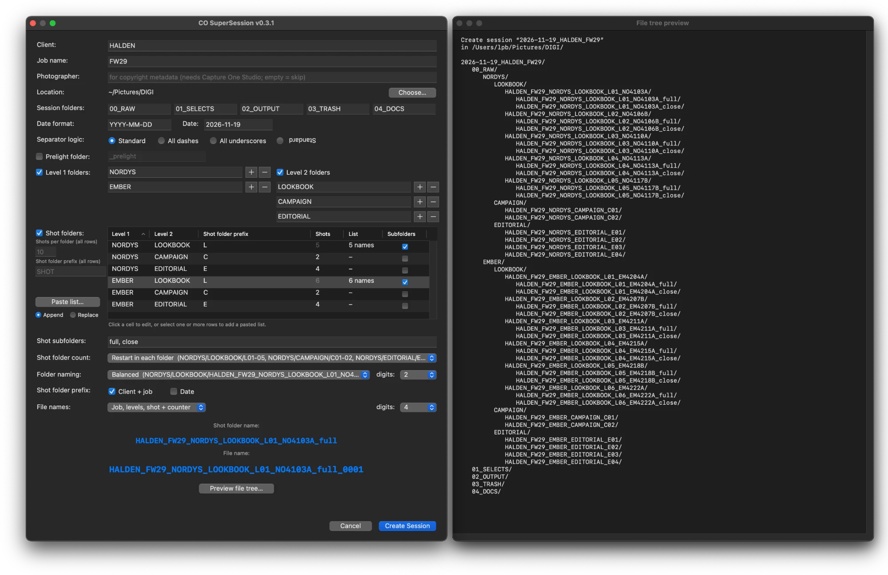

# CO SuperSession

A Capture One 16 script that sets up a complete, consistently named session from a single window.

Starting a shoot in Capture One usually means creating the session, renaming its folders, making a folder for every shot, setting the capture naming and adding copyright. CO SuperSession does all of that at once. You enter the client, the job and how the shoot is organised, check the preview, and start capturing.



## What it does

- Names the session from the date, client and job, for example `2026-11-14_LUMARA_Night-Glow`
- Creates your own folder layout (RAW, selects, output, trash, documents) and points Capture One at it
- Builds the folders for the shoot: a prelight folder, level folders such as days or locations, numbered shot folders and shot subfolders
- Takes a pasted list of names, such as SKUs, looks or talent, one per line, so each shot folder carries its own name. It warns you if two folders would end up with the same name
- Sets the capture file naming so every image carries the job and shot it belongs to
- Adds the photographer's copyright to every capture
- Shows the resulting folder tree and a sample file name before anything is created, and flags problems such as a folder that already exists
- Remembers your choices for the next session, and saves them as named presets for repeat clients

A two-day shoot for the lamp brand Lumara, with three key visuals (prefix KV) a day, might look like this:

```
2026-11-14_LUMARA_Night-Glow/
├── 00_RAW/
│   ├── _prelight/
│   ├── DAY1/
│   │   ├── KV01/
│   │   ├── KV02/
│   │   └── KV03/
│   └── DAY2/
│       ├── KV04/
│       ├── KV05/
│       └── KV06/
├── 01_SELECTS/
├── 02_OUTPUT/
├── 03_TRASH/
└── 04_DOCS/
```

A fashion shoot can go a level deeper. Here the brand Halden shoots its FW27 season. It uses two collections, NORDYS and EMBER, as level 1 folders, with LOOKBOOK, CAMPAIGN and EDITORIAL as level 2 folders. The lookbook shots use the prefix L, the campaign shots C and the editorial shots E, and numbering restarts in each folder. The lookbook rows get a pasted list of SKU codes (Paste list, Append), so each look folder carries its SKU, and the number of codes sets the number of looks: five for each collection. Only the lookbook rows have Subfolders ticked, so each look gets a full and a close subfolder. The campaign rows have Custom subfolders instead, so each campaign shot gets a main and a plates subfolder. There is no prelight folder. Folder naming is Balanced with the Shot folder prefix (client + job): the level 1 and level 2 folders keep short names, and each shot folder, and so every capture in it, carries the client, job, collection and level 2 folder. File names use Job, levels, shot + counter:

```
2026-11-19_HALDEN_FW27/
├── 00_RAW/
│   ├── NORDYS/
│   │   ├── LOOKBOOK/
│   │   │   ├── HALDEN_FW27_NORDYS_LOOKBOOK_L01_NO4103A/
│   │   │   │   ├── HALDEN_FW27_NORDYS_LOOKBOOK_L01_NO4103A_full/
│   │   │   │   └── HALDEN_FW27_NORDYS_LOOKBOOK_L01_NO4103A_close/
│   │   │   ├── HALDEN_FW27_NORDYS_LOOKBOOK_L02_NO4106B/
│   │   │   │   ├── HALDEN_FW27_NORDYS_LOOKBOOK_L02_NO4106B_full/
│   │   │   │   └── HALDEN_FW27_NORDYS_LOOKBOOK_L02_NO4106B_close/
│   │   │   ├── HALDEN_FW27_NORDYS_LOOKBOOK_L03_NO4110A/
│   │   │   │   ├── HALDEN_FW27_NORDYS_LOOKBOOK_L03_NO4110A_full/
│   │   │   │   └── HALDEN_FW27_NORDYS_LOOKBOOK_L03_NO4110A_close/
│   │   │   ├── HALDEN_FW27_NORDYS_LOOKBOOK_L04_NO4113A/
│   │   │   │   ├── HALDEN_FW27_NORDYS_LOOKBOOK_L04_NO4113A_full/
│   │   │   │   └── HALDEN_FW27_NORDYS_LOOKBOOK_L04_NO4113A_close/
│   │   │   └── HALDEN_FW27_NORDYS_LOOKBOOK_L05_NO4117B/
│   │   │       ├── HALDEN_FW27_NORDYS_LOOKBOOK_L05_NO4117B_full/
│   │   │       └── HALDEN_FW27_NORDYS_LOOKBOOK_L05_NO4117B_close/
│   │   ├── CAMPAIGN/
│   │   │   ├── HALDEN_FW27_NORDYS_CAMPAIGN_C01/
│   │   │   │   ├── HALDEN_FW27_NORDYS_CAMPAIGN_C01_main/
│   │   │   │   └── HALDEN_FW27_NORDYS_CAMPAIGN_C01_plates/
│   │   │   └── HALDEN_FW27_NORDYS_CAMPAIGN_C02/
│   │   │       ├── HALDEN_FW27_NORDYS_CAMPAIGN_C02_main/
│   │   │       └── HALDEN_FW27_NORDYS_CAMPAIGN_C02_plates/
│   │   └── EDITORIAL/
│   │       ├── HALDEN_FW27_NORDYS_EDITORIAL_E01/
│   │       ├── HALDEN_FW27_NORDYS_EDITORIAL_E02/
│   │       ├── HALDEN_FW27_NORDYS_EDITORIAL_E03/
│   │       └── HALDEN_FW27_NORDYS_EDITORIAL_E04/
│   └── EMBER/
│       ├── LOOKBOOK/
│       │   ├── HALDEN_FW27_EMBER_LOOKBOOK_L01_EM4204A/
│       │   │   ├── HALDEN_FW27_EMBER_LOOKBOOK_L01_EM4204A_full/
│       │   │   └── HALDEN_FW27_EMBER_LOOKBOOK_L01_EM4204A_close/
│       │   ├── HALDEN_FW27_EMBER_LOOKBOOK_L02_EM4207B/
│       │   │   ├── HALDEN_FW27_EMBER_LOOKBOOK_L02_EM4207B_full/
│       │   │   └── HALDEN_FW27_EMBER_LOOKBOOK_L02_EM4207B_close/
│       │   ├── …
│       │   └── HALDEN_FW27_EMBER_LOOKBOOK_L05_EM4218B/
│       │       ├── HALDEN_FW27_EMBER_LOOKBOOK_L05_EM4218B_full/
│       │       └── HALDEN_FW27_EMBER_LOOKBOOK_L05_EM4218B_close/
│       ├── CAMPAIGN/
│       │   ├── HALDEN_FW27_EMBER_CAMPAIGN_C01/
│       │   │   ├── HALDEN_FW27_EMBER_CAMPAIGN_C01_main/
│       │   │   └── HALDEN_FW27_EMBER_CAMPAIGN_C01_plates/
│       │   └── HALDEN_FW27_EMBER_CAMPAIGN_C02/
│       │       ├── HALDEN_FW27_EMBER_CAMPAIGN_C02_main/
│       │       └── HALDEN_FW27_EMBER_CAMPAIGN_C02_plates/
│       └── EDITORIAL/
│           ├── HALDEN_FW27_EMBER_EDITORIAL_E01/
│           ├── …
│           └── HALDEN_FW27_EMBER_EDITORIAL_E04/
├── 01_SELECTS/
├── 02_OUTPUT/
├── 03_TRASH/
└── 04_DOCS/
```

A capture in the close subfolder of the second Ember look could then be named `HALDEN_FW27_EMBER_LOOKBOOK_L02_EM4207B_close_0001`.

When the session is ready, Capture One opens on the first capture folder.

## Folder terms

- **Level 1 and level 2 folders**: the groups you type, such as days, locations or collections. Level 2 folders sit inside each level 1 folder.
- **Shot folder**: any folder directly inside the last level folder (level 2 if used, otherwise level 1), or directly inside RAW when there are no level folders. `L01`, `KV03` and `SHOT01_NL4102` are shot folders.
- **Shot subfolder**: a folder inside a shot folder, from Shot subfolders or Custom subfolders (`KV1/KV1_plates`).
- **Capture folder**: any folder at the deepest level inside RAW, the folder you actually capture into. That is a shot subfolder where a shot folder has them, otherwise the shot folder itself, the last level folder with Shot folders off, or the prelight folder.

## Design requirements

These are the rules the script is built to keep. New features have to keep them too.

**Naming**

- **Every capture file identifies itself.** A file name alone says which job, level 1 and level 2 folders and shot it belongs to. Capture One can only put the capture folder's own name in a file name, so the script fills Capture One's [Name] token with whatever that folder name is missing. When a naming choice leaves something out, a note says so.
- **Shot folders are either simple or fully mobile, nothing in between.** A shot folder has a plain name (Simple) or carries everything above it in its name (Balanced, Dense), so it can be moved or sent anywhere without losing its context.
- **Nothing is said twice.** The job never appears twice in a file name, and with Balanced naming only the folder you capture into repeats the folders above it.
- **Names sort by date.** When the date is in a name, it always comes before the job, so sessions, folders and files sort in date order.
- **Every name is unique.** Two folders that would get the same name, even if they differ only in capitals (RAW and raw), are flagged before anything is created.

**Safety**

- **You see the result before anything is created.** The preview shows the full folder tree, every folder listed, and a sample file name, and updates as you type.
- **Nothing fails silently.** Problems, lost information and errors are reported instead of being skipped.
- **The order you view things in never changes what gets built.** Grouping the shot folder table by a column changes only the display; folders are still created and numbered in level 1 order.

**Convenience**

- **Set it once for every row, then override any row.** Values in the "(all rows)" fields fill every row you haven't typed a value into yourself. Clear a row's value to make it follow that field again.
- **Your choices persist.** Settings are remembered between runs, kept through updates and carried over when a setting is renamed or redesigned, even settings a session couldn't use.
- **One window, top to bottom.** The whole session is set up from a single window that grows to fit its content, so the shot folder table never scrolls.
- **It works for everyone.** Accented names (Zoë, Café) are kept intact, and users without Capture One Studio get their copyright through a saved metadata style.

## System requirements

- macOS
- Capture One 16

Writing copyright directly needs Capture One Studio. Without Studio, the script can apply a saved metadata style instead.

> [!CAUTION]
> Updates within Capture One 16 are fine. After a major upgrade (17 or later), test the script on a throwaway session before a real shoot. A new version may not be found by the script, or may change the scripting commands it relies on. If the script asks where Capture One is, open **CO SuperSession.scpt** in Script Editor, choose Capture One when asked, and save. If you have the source, you can run `./install.sh` again instead. Having two major versions installed at once can make the script open the wrong one.

## Installation

1. Download the latest **CO-SuperSession** zip from the [Releases page](../../releases) and double-click it to unzip.
2. In Capture One, choose **Scripts › Open Scripts Folder** and drag **CO SuperSession.scpt** into the folder that opens.
3. Choose **Scripts › Update Scripts Menu**, then **Scripts › CO SuperSession**.

## Using it

The window works from top to bottom, and the preview updates as you type. Hover over a field for a hint.

1. **Client, job and photographer.** These make up the session name and the copyright. **Location** is where the session folder is created. Use **Choose…** to change it.
2. **Session folders.** Name the RAW, selects, output, trash and documents folders.
3. **Date format and separators.** Set how the date is written (for example `YYYY-MM-DD` or `YYMMDD`) and which characters join the parts of each name.
4. **Prelight folder.** If you turn it on, a folder is created inside RAW and used as the first capture folder.
5. **Level 1 folders.** Add groups such as days, locations or collections. Turn on **Level 2 folders** to add a second level inside each one, for example `Studio/DAY1`.
6. **Shot folders.** Each row in the table is one group of shots. Click a cell to change its shot folder prefix or its number of shots. Type a number in **Shots per folder (all rows)** (10 the first time) to use it for every row. Type a prefix in **Shot folder prefix (all rows)** (SHOT the first time) to use it for every row whose folder prefix you haven't typed in the table; clear a row's prefix to make it follow that field again. With Level 2 folders on, there is one row per level 1 and level 2 pair (`Studio/DAY1`, `Studio/DAY2`, `Rooftop/DAY1`…), shown in the **Level 1** and **Level 2** columns. Click either header to group the rows by it. The table grows to show every row without scrolling; drag the window's bottom edge to make it taller still (remembered).
7. **Pasted lists.** Select one or more rows (⌘A selects all), then click **Paste list…** or the row's **List** cell. Paste one name per line and press ⌘Return. The number of names sets the number of shots for that row. **Remove list** goes back to plain numbering. Choose how the names are used:
   - **Append** keeps the number and adds the name: `SHOT01_NL4102`
   - **Replace** uses the name as the folder: `NL4102`
8. **Shot subfolders.** Optional. Type a short list such as `main, plates` or `full, medium, close` to get those folders inside every shot folder. They are not numbered, and each is named after its shot (`SHOT01/SHOT01_main`), so the shot stays in the capture file name. Only table rows with **Subfolders** checked get them; untick a row to keep its shot folders plain. To give a row extra subfolders of its own, click its **Custom subfolders** cell and paste them, one per line (select several rows first to give them all the same list); they are added to that row's shot folders on top of the shot subfolders, and work even with Subfolders unticked.
9. **Shot folder count.** Choose whether numbering restarts in each folder, continues per shot prefix, or continues across all folders.
10. **Folder naming.** Choose how much of the folders above it each folder name repeats:
   - **Simple**: plain names: `NORDLYS/LOOKBOOK/L01`
   - **Balanced**: only the folder you capture into carries the folders above it: `NORDLYS/LOOKBOOK/NORDLYS_LOOKBOOK_L01`
   - **Dense**: every folder carries the folders above it: `NORDLYS/NORDLYS_LOOKBOOK/NORDLYS_LOOKBOOK_L01`

   Shot folders are either simple or fully mobile. With Balanced or Dense, a shot folder keeps all the information it needs in its own name, so moving it out of the session or sending it on its own loses nothing; add the **Shot folder prefix** to carry the client + job (and date) too.

   **Shot folder prefix** puts the client + job, and optionally the date, in front of those prefixed folder names. The date always comes with the client + job, so file names keep the date before the job. **digits** sets the digits of the shot number. With **Shot folders** off you capture straight into the last level, so Balanced gives it the full name (`KV1/KV1_main`).
11. **File names.** Choose one of three. **Simple** gives a file prefix plus the counter (`ACME_job_0001`); type the prefix in the field next to the popup, or leave it empty to use the client + job. For the other two, Capture One can only put the name of the folder you capture into in a file name, so the script fills Capture One's [Name] token with whatever that folder name is missing. **Job, levels, shot + counter** carries the job, every level 1 and level 2 folder, the shot and the counter; **Date, job, levels, shot + counter** starts with the date too (always, when the folder prefix has the date). **digits** sets the length of the counter. With **Simple** folder naming, those two keep only the level 1 and level 2 folders every capture folder shares; a note says which are left out. Simple file names are only unique if Capture One's counter isn't reset when switching folders.
12. **Check the preview.** A sample file name and any problems, such as a folder that already exists, appear above the buttons. Click **Preview file tree…** (⌘P) to see the whole folder tree in its own window, which follows your edits. Click **Create Session** to build it.
13. **Presets.** Optional. **Presets** at the bottom left saves every setting in the window under a name (**Save Preset…**) and loads it again in one click, replacing what is in the window. **Delete Preset** removes one.

## Updating

1. Download the newer **CO-SuperSession** zip from the [Releases page](../../releases) and unzip it.
2. Close the script's window if it is open.
3. In Capture One, choose **Scripts › Open Scripts Folder**, drag the new **CO SuperSession.scpt** into it and choose **Replace**. If Finder won't replace it, move the old file to the Bin first, then drag in the new one. If an older **CO Super Session.scpt** (with a space) is there, move it to the Bin too.
4. Choose **Scripts › Update Scripts Menu**, or restart Capture One.
5. Run the script and check that the window title shows the new version.

Your saved choices are kept, because they are stored separately from the script file.

If you installed from the source, get the latest source and run `./install.sh` from its folder in Terminal. It replaces the installed copy for you.

## What's new

See the [changelog](CHANGELOG.md) for what changed in each version, including changes not yet released.

## Customising

A few defaults live at the top of `CO SuperSession.applescript`, including a session template to start from and a copyright style for users without Studio. To change them, download the source, edit the file and run `./install.sh` from its folder in Terminal. This builds the script and installs it in Capture One's Scripts folder.

## Credits

Originally written in 2019 as SuperSession by Louis-Philippe Beauduin. Rewritten in 2026 for Capture One 16 with the help of Claude Code.

## License

Copyright © 2026 Louis-Philippe Beauduin. CO SuperSession is free software under the [GNU General Public License v3.0](LICENSE) or any later version. You can use, share and change it. If you share a changed version, you must release its source under the same licence.
